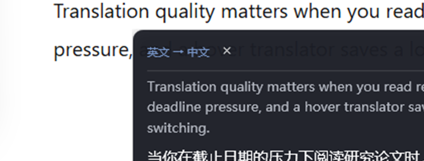

# 悬停翻译 HoverTranslate

鼠标停在屏幕上的任何文字处，0.3 秒后自动弹出译文卡片。不选中、不复制、不切换窗口。

Windows 与 macOS 双平台，中英双向翻译。



## 它解决什么问题

读英文文档、看英文网页、处理外文合同时，传统做法是选中文字、复制、切到翻译网站、粘贴、切回来。一次两次还行，一天几十次就是纯浪费。

这个工具把整套动作压成"把鼠标停上去"。

## 特性

- 悬停取词：鼠标静止约 0.3 秒自动翻译光标下的文本，移开即收起
- 双向翻译：自动识别语种，也可固定为英译中或中译英
- 不打扰：卡片出现在鼠标旁边，不抢焦点、不打断输入
- 内容型取词：只翻正文，鼠标掠过按钮、菜单、标题栏不会乱弹
- 三级引擎降级：腾讯交互翻译 → 有道 → MyMemory，主引擎响应 0.2-0.4 秒
- 本地缓存：同一段文字重复悬停不重复请求
- 单文件免安装（Windows），原生菜单栏应用（macOS）

## 下载与安装

### Windows

下载 [Releases](https://github.com/leoga0/HoverTranslate/releases) 里的 `HoverTranslate.exe`，放到任意普通目录（例如 `D:\Tools\HoverTranslate\`），双击运行。

任务栏右下角出现蓝色「译」图标即已启动，程序常驻后台，没有主窗口。

> 不要放在受策略管控的目录（例如某些沙箱工作区）下运行 —— 系统会把进程降为低完整性，此时读不到其他程序的界面文字。

不确定的话直接从源码构建，见 [`windows/README.md`](windows/README.md)。

### macOS

需要 macOS 11 以上和 Xcode Command Line Tools：

```bash
xcode-select --install
git clone https://github.com/leoga0/HoverTranslate.git
cd HoverTranslate/mac
bash build.sh
```

产物是 `mac/build/HoverTranslate.app`，拖进「应用程序」即可。首次运行需要在「系统设置 → 隐私与安全性 → 辅助功能」里勾选本程序。

细节见 [`mac/README.md`](mac/README.md)。

## 用法

鼠标停在文字上不动，旁边浮出卡片：灰色小字是原文，大字是译文。

- 按住卡片可拖动
- 右键复制译文
- 点 × 关闭
- 鼠标移开取词位置一段距离后自动收起

### 快捷键

| 功能 | Windows | macOS |
| --- | --- | --- |
| 立即翻译光标处文字（取不到则翻剪贴板） | Ctrl+Alt+T | Control+Option+T |
| 切换翻译方向 | Ctrl+Alt+D | Control+Option+D |
| 暂停 / 恢复悬停 | Ctrl+Alt+H | Control+Option+H |

方向顺序：自动识别 → 英译中 → 中译英 → 循环。

### 托盘 / 菜单栏

悬停开关、翻译方向、深浅色、字号、是否显示原文、开机自启（Windows）、辅助功能设置（macOS）、退出。

## 工作原理

### Windows

取词走两条通道：

1. **UI Automation**：`AutomationElement.FromPoint` 拿到光标下的元素，读 `Name` / `Value` / `TextPattern`，容器节点向下找包含光标的文本子元素
2. **MSAA**：UIA 在 Chromium 内核浏览器上会走到 MSAA 代理并被系统拒绝，此时改用 `AccessibleObjectFromPoint` 取 `IAccessible`，必要时遍历子对象

文本整形后送翻译引擎，结果显示在无边框置顶浮窗（`WS_EX_NOACTIVATE`，不抢焦点）。

### macOS

用 Accessibility API：`AXUIElementCopyElementAtPosition` 定位光标下的元素，读 `AXValue` / `AXSelectedText` / `AXTitle` / `AXDescription`；读到容器就向下找子元素，仍为空则沿父链向上找。浮窗用 `NSPanel`（`.nonactivatingPanel`）实现。

## 翻译引擎

| 顺序 | 引擎 | 说明 |
| --- | --- | --- |
| 1 | 腾讯交互翻译 | 免费接口，中英质量稳定，实测 0.2-0.4 秒 |
| 2 | 有道翻译 | 备用 |
| 3 | MyMemory | 兜底 |

三个都是公开免费接口，不需要 API Key。请求失败自动降级，全部失败时卡片显示错误原因。

## 目录结构

```
HoverTranslate/
├── windows/           Windows 版（C# / WPF，csc 直接编译，无第三方依赖）
│   ├── src/
│   ├── assets/
│   └── build.ps1
├── mac/               macOS 版（Swift / AppKit）
│   ├── Sources/
│   ├── Info.plist
│   ├── icon.png
│   └── build.sh
└── docs/
```

## 已知限制

- 图片里的文字、扫描版 PDF、视频画面需要 OCR，当前版本不含
- 以管理员权限运行的软件：普通权限启动的翻译器读不到它的界面
- 全屏独占的游戏取不到
- macOS 版的多显示器定位在分辨率差异极大的场景下可能偏差十几像素

取不到文字时，选中文字后按快捷键，或先复制再按快捷键。

## 反馈

开 issue 就行，附上系统版本和复现步骤。macOS 版还没在真机验证过编译，报错请把终端里的完整错误贴上来。

## License

MIT
